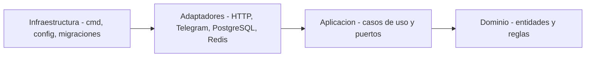

# Fase 7 — Enfoque arquitectónico: Clean Architecture

**Pregunta guía:** ¿Qué estructura arquitectónica aplicamos para organizar responsabilidades y dependencias?

**Enfoque elegido:** **Clean Architecture (con puertos y adaptadores).** Las dependencias del código apuntan siempre **hacia el centro**: el dominio no conoce Telegram, PostgreSQL, Redis ni HTTP.

### 7.1 Capas y ejemplos de este proyecto

| Carpeta | Capa | ¿Qué contiene? | Ejemplos en CRM-TELEGRAM |
|---------|------|----------------|--------------------------|
| `domain/` | Dominio | Entidades, objetos de valor y reglas de negocio. | `Contacto`, `Bot`, `Etiqueta`, `Segmento`, `Campana`, `Entrega`; regla: un contacto bloqueado no recibe campañas. |
| `application/` | Aplicación | Casos de uso y **puertos** (interfaces). | `RegistrarContactoDesdeStart`, `CrearEnlaceIngreso`, `AsignarEtiquetas`, `CrearCampana`, `ProcesarEntrega`; puertos `RepositorioContactos`, `EnviadorMensajes`, `ColaEnvios`. |
| `adapters/` | Adaptadores | Implementan los puertos y traducen formatos. | Controlador HTTP, receptor de webhook de Telegram, repositorio PostgreSQL, cola Redis, cliente de Telegram. |
| `platform/` | Infraestructura | Configuración, logs, migraciones, arranque. | `config`, `logger`, `migrations`, `cmd/api`, `cmd/worker`. |

### 7.2 Regla de dependencia



Cómo se aplica con un ejemplo, el **registro de un contacto**:
1. El adaptador `telegram/webhook` recibe el update y lo traduce a un comando.
2. El caso de uso `RegistrarContactoDesdeStart` aplica las reglas (duplicado por `bot_id` + `telegram_user_id`, sumar procedencia).
3. Usa el puerto `RepositorioContactos`, implementado por el adaptador `postgres`.
4. El dominio decide el estado inicial del contacto sin saber nada de Telegram ni de SQL.

### 7.3 Estructura de carpetas sugerida (backend)

```text
backend/
├─ cmd/
│  ├─ api/main.go            # arranca la API y el webhook
│  └─ worker/main.go         # arranca la cola y las campañas
├─ internal/
│  ├─ domain/                # sin dependencias externas
│  │  ├─ contacto/  bot/  etiqueta/  segmento/  campana/  entrega/  usuario/
│  ├─ application/
│  │  ├─ contactos/  enlaces/  etiquetas/  segmentos/  campanas/  entregas/
│  │  └─ puertos/            # interfaces que exige la aplicación
│  ├─ adapters/
│  │  ├─ http/               # REST (panel y futuras integraciones)
│  │  ├─ telegram/           # webhook y cliente de la Bot API
│  │  ├─ postgres/           # repositorios
│  │  └─ redis/              # cola y control de ritmo
│  └─ platform/              # config, logger, seguridad, migraciones
└─ migrations/
```

### 7.4 Patrones complementarios

| Patrón | Dónde se usa |
|--------|--------------|
| Repository | Acceso a PostgreSQL por módulo. |
| Adapter | Cliente de Telegram detrás del puerto `EnviadorMensajes`. |
| Outbox / estado de entrega persistido | Cada envío queda en `deliveries` antes de intentarse. |
| Idempotencia | Clave por update de Telegram y por entrega, para evitar duplicados. |
| Strategy | Distintos tipos de mensaje (texto, imagen, PDF, botones). |
