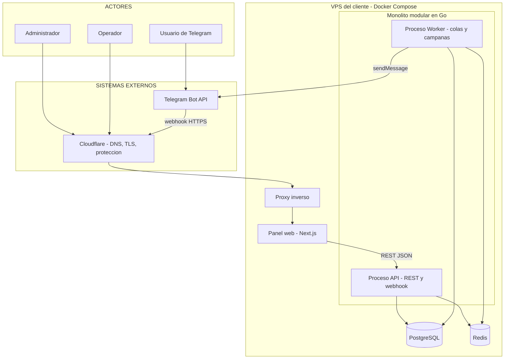
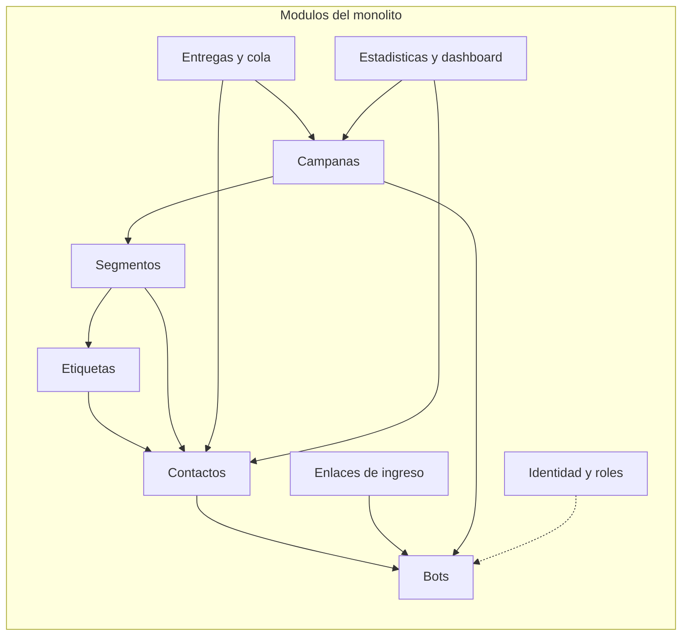

# Fase 6 — Estilo arquitectónico

**Pregunta guía:** ¿Cómo estructuramos globalmente el sistema?

**Estilo elegido:** **Monolito modular + arquitectura en capas**, desplegado como dos procesos (API y Worker) más un panel web.
*(Capas = organización lógica; monolito = unidad de despliegue; pueden coexistir.)*

### 6.1 Diagrama de contexto y despliegue

### 6.2 Módulos del monolito

**Reglas de los módulos** (inspiradas en la Guía 03):
1. Cada módulo tiene su carpeta y su propio caso de uso.
2. Un módulo **no lee las tablas de otro**; se comunica llamando a su servicio o puerto.
3. Las dependencias van de arriba hacia abajo (campañas depende de segmentos, no al revés).
4. Todo se despliega como una sola base de código; el worker reutiliza los mismos módulos.

### 6.3 Modelo de datos inicial (borrador a refinar con Spec Kit)

| Tabla | Contenido clave |
|-------|-----------------|
| `workspaces` | Negocio o cliente que usa el sistema (⚠️ ver ADR-011). |
| `users` | Email, hash de contraseña, rol (`ADMIN`, `OPERADOR`), permisos. |
| `bots` | Nombre, token cifrado, secreto de webhook, estado, `workspace_id`. |
| `contacts` | `bot_id`, `telegram_user_id`, nombre, apellido, username, estado, fecha de registro. Único `(bot_id, telegram_user_id)`. |
| `entry_links` | Código corto, área, programa, origen, grupo/campaña, `bot_id`. |
| `contact_entries` | Cada ingreso del contacto: enlace usado y fecha (historial de procedencia). |
| `tags` / `contact_tags` | Etiquetas por bot y su asignación a contactos. |
| `segments` | Reglas guardadas (JSONB) por bot. |
| `campaigns` | Bot, destinatarios (segmento/etiqueta/selección), contenido, programación, estado. |
| `deliveries` | Una fila por contacto y campaña: estado, intentos, error, fechas. |
| `contact_status_history` | Cambios de estado con motivo y fecha. |
| `audit_log` | Quién hizo qué y cuándo. |
